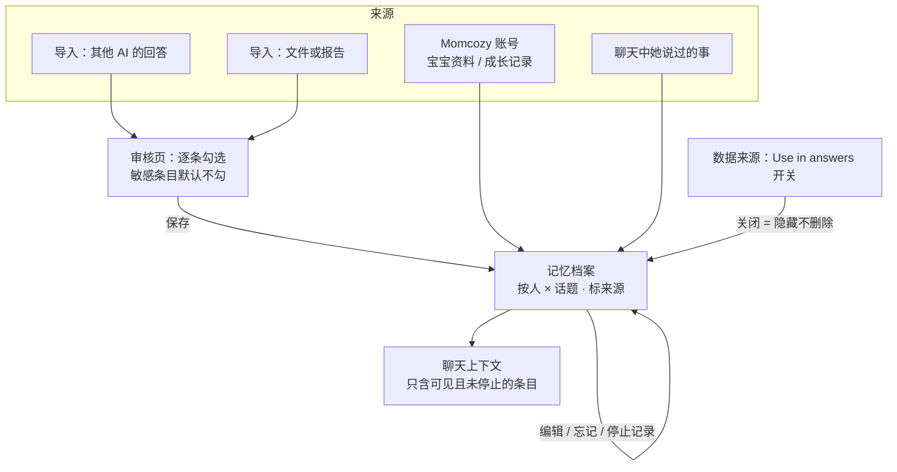

# PRD · Cozie 记忆系统与资料上传

> 依据：CozyAI demo 当前实现（截至 2026-11-24）。覆盖三部分：记忆档案（Memory profile）、数据来源（Data sources）、资料上传（导入其他 AI 的记忆 / 上传文件或报告）。界面文案保留英文原文。未确认信息统一标注 `[待补充：…]` 并列入第 14 章。

---

## 1. 基础信息

| 字段 | 内容 |
|---|---|
| 产品负责人 | [待补充：需求 Owner 姓名] |
| 版本 | v0.1 |
| 状态 | 草稿 |
| 需求类型 | 新功能 |
| 关联文档 | Onboarding PRD：docs/prd-onboarding.md；评审材料：docs/onboarding-review.md（第 4.8、6 节）；可体验 demo：[待补充：线上地址]；Figma：[待补充]；技术方案（聊天记忆提取、存储与加密）：[待补充] |

## 2. 需求背景

- **业务背景**：Cozie 的核心差异是"认识她"：Momcozy 账号与设备数据、聊天中她说过的事、她从别处带来的资料。要让个性化可持续，Cozie 需要一个用户**看得见、改得了、管得住**的记忆系统，以及把已有资料带进来的上传通道。
- **用户问题**：
  1. 每次换一个 AI 都要从头讲一遍宝宝和自己的情况，很累。
  2. 不知道 AI 记住了什么、从哪来的，担心隐私，尤其是健康和宝宝的信息。
  3. 已有的记录（其他 AI 的对话、体检报告、Huckleberry 等记录类 App 的导出）无法被 Cozie 利用。
  4. 不想让 AI 记录某类话题时，没有办法明确表达。
- **问题影响**：用户不敢或懒得提供信息 → 回答不够个性化 → Cozie 与通用 AI 无差异；隐私担忧影响信任与留存，并带来合规风险。
- **相关证据**：[待补充：用户调研 / 客服关于"AI 记住了什么""隐私"的反馈；竞品记忆功能使用数据]

**需求价值**

| 维度 | 价值 |
|---|---|
| 用户价值 | 不用重复讲；Cozie 记住的每一条都标来源、可编辑、可删除；可让 Cozie 不记某个话题；关掉某个来源就不再使用；导入资料逐条确认才保存，健康类默认不保存 |
| 商业价值 | 提高资料授权与导入率，提升回答个性化程度与留存；增强隐私信任与品牌口碑 [待补充：对应 KPI] |
| 战略价值 | 家庭级记忆与多来源数据沉淀，构建个性化壁垒 |

## 3. 用研和数据验证

**3.1 用户需求与场景验证**：[待补充：访谈验证"重复讲述"痛点、对记忆功能的期望与顾虑；导入其他 AI 记忆的意愿]

**3.2 关键功能与交互方案验证**：可用性测试验证：用户能否找到记忆档案、看懂来源标签、完成编辑 / 忘记 / 停止记录；能否完成"导入其他 AI 的记忆"全流程（发邮件 → 在 AI 里运行 → 粘贴回来 → 审核保存）；能否理解"关掉来源 = 隐藏不删除"。

**3.3 产品价值、用户价值与成功指标**

> Benchmark 为团队基线值，**目标值待与业务确认**。

| 维度 | 衡量指标 | 成功标准（Benchmark） | 验收/评估方式 |
|---|---|---|---|
| 用户价值\* | 导入完成率：开始导入 → 保存至少 1 条 | [待补充：目标值]（基线：关键流程完成率 ≥60%） | 埋点漏斗：`memory_import_start` → `memory_import_review_view` → `memory_import_save` |
| 用户价值\* | 记忆档案渗透率：Cozie 活跃用户中打开过记忆档案的比例 | [待补充]（基线：功能稳定渗透率 ≥10%） | 埋点：`memory_profile_view` |
| 用户价值\* | 导入用户留存：完成导入的用户次周留存 | [待补充]（基线：次周留存 ≥35%） | 以 `memory_import_save` 为起始事件 |
| 用户价值 | 审核保留率：审核页中最终保存的条目比例 | [待补充] | `memory_import_save.saved_count / items_count` |
| 用户价值 | 控制行为占比：编辑、忘记、停止记录、关闭来源的使用情况（衡量信任与可控，非越多越好） | 观察指标 | 埋点：`memory_entry_edit` / `memory_entry_forget` / `memory_topic_block` / `data_source_toggle` |
| 软件质量体验\* | SQE | ≥5.5 / 7 | 用研问卷 |
| 精准度 | 导入提取准确率：抽样中归类正确、无编造的条目比例 | [待补充]（参考：意图识别 ≥98%） | 模型评测：标准样本集（AI 回答 / 报告 / CSV）回归测试 |
| 安全性 | 敏感条目默认不勾选覆盖率 | 100%（健康、用药、检查结果、诊断、心理、关系冲突） | 负向测试 |
| 响应性 | 导入解析耗时 | [待补充：P95 目标] | 性能压测 |

**3.4 效果复盘**：上线后 T+7、T+15、T+30 复盘，之后每月例行复盘。重点看导入各步流失（尤其"发邮件后是否回来粘贴"）、文件类型分布与解析失败率。

## 4. 竞品分析

- **竞品选择**：ChatGPT Memory、Claude 记忆 / 项目知识、Gemini 个性化（通用 AI 的记忆做法）；Huckleberry 等婴儿记录 App（数据来源）。
- **关键发现**：通用 AI 的记忆多为"模型自动记 + 用户在设置里删"，来源不可见、无法按话题停止；跨产品迁移基本靠用户手动复制。
- **对本需求的启示**：借鉴"可查看、可删除"；差异化在于**每条记忆标来源**、**按家庭成员 × 话题组织**、**可按话题停止记录**、**关闭来源即隐藏**，以及**从其他 AI 一键迁移**（邮件提示词 + 粘贴回答）与**记录类 App 导出在手机上先汇总再上传**。
- **竞品分析文档**：[待补充]

## 5. 用户核心场景

**目标用户**：已使用 Cozie 的妈妈（产后为主），家中可能有多个孩子。

**核心使用场景**
1. 当妈妈想知道 Cozie 记住了她和宝宝什么时，她想要按人、按话题看清楚每一条及其来源，以便放心地继续用。（P0）
2. 当她发现某条记忆不准或不想被记住时，她想要直接编辑或忘记它，以便 Cozie 用对的信息回答。（P0）
3. 当她不希望 Cozie 记录某类话题（如健康信息）时，她想要一键"停止记录"这个话题，以便以后也不被记。（P0）
4. 当她不想让某个来源（如 Momcozy 账号、某次导入）参与回答时，她想要关掉它而不删除，以便随时再打开。（P0）
5. 当她已经在 Claude / ChatGPT 里聊过很多育儿的事时，她想要把那些内容带进 Cozie，以便不用从头讲。（P0）
6. 当她有体检报告、Huckleberry 导出或报告照片时，她想要上传给 Cozie，以便回答参考这些信息。（P1）

## 6. 需求概述

**功能摘要**：让妈妈看清、改动、管住 Cozie 记住的家庭信息，并能把其他 AI 的记忆和已有报告、记录带进来，每条都由她确认、标明来源、随时可删。

**流程图**

**需求配图**：[待补充：记忆档案页、停止记录两态、数据来源页（星图）、导入审核页]

**需求详情一致性**：以本文档为准。

**Feature List（功能清单）**
- 记忆档案入口：从聊天历史抽屉 / 信件来源说明 / 设置进入 —> 打开 Memory profile。
- 家庭成员切换：在顶部环形头像或 View all 列表中选择妈妈或某个宝宝 —> 显示这个人的记忆卡片。
- 记忆卡片：每个话题一张卡 —> 看到 Cozie 记住的字段与条目、摘要、来源标签。
- 编辑：点 Edit —> 在底部弹层修改，保存后 Cozie 按新说法使用，引用旧内容的摘要失效。
- 忘记：点 Forget 并确认 —> 条目删除，不可撤销。
- 停止记录：点 Stop remembering this 并确认 —> 忘掉该卡已存内容、以后不再记录，卡片变为静止态；点 Remember again —> 恢复为空的初始卡。
- 数据来源开关：在 Data sources 关掉某个来源 —> 该来源的条目在记忆档案与聊天中隐藏，不删除；再打开即恢复。
- 导入其他 AI 的记忆：发邮件或直接打开 Claude / ChatGPT 运行提示词，把回答粘贴回来 —> 看到提取出的条目，逐条确认后保存。
- 上传文件或报告：选择 PDF / Word / CSV / 照片 —> 看到提取出的条目，逐条确认后保存。
- 删除一次导入：在 Data sources 展开某次导入 —> 一键删除它带来的全部条目。
- 记忆总开关与重置：在设置中关闭 Enable memory / Reset Cozie memory —> Cozie 不再保存和使用记忆 / 清空记忆。

**范围边界 — 本期包含**
- 记忆档案页：家庭成员切换、按话题的记忆卡片、字段与条目、摘要、来源标签、编辑、忘记、健康信息默认折叠、停止记录 / 恢复、来源关闭后的隐藏提示。
- 数据来源页：星图（Cozie 对家庭的了解程度）、Momcozy 账号与各设备的 Use in answers 开关、Apple Health（仅预览）、导入列表（开关、查看、删除）、新增导入入口。
- 导入其他 AI 的记忆（邮件 / 直接打开 AI / 复制提示词 → 粘贴 → 解析 → 审核 → 保存）。
- 上传文件或报告（PDF 含扫描件、Word、纯文本、记录类 App CSV、照片 → 解析 → 审核 → 保存）。
- 设置：Enable memory、Reset Cozie memory。
- 聊天上下文：只带可见、未停止记录、来源开启的条目，并告知模型她停止记录的话题。

**范围边界 — 本期不包含**
- Apple Health 真实连接：仅预览状态，连接流程另行立项。
- 记录类 App 的持续同步（如 Huckleberry API）：本期只支持一次性导出文件。
- 回复邮件导入（把 AI 回答通过回复邮件发回来）：本期只支持在 App 内粘贴，回传方式待定。
- 家人共享记忆档案：本期不做。
- 记忆导出（下载）：[待补充：是否本期做，GDPR 数据可携带权要求]

**对现有功能的影响**
- 聊天：每次提问附带的记忆上下文改为过滤后的版本（来源关闭、话题停止的条目不带），并附"她要求不要记的话题"。
- 信件 / 预览弹窗：来源说明与 "Make answers sharper" 入口指向本系统。
- 数据来源关闭后，Onboarding 中的 I noticed 观察按无数据处理（见 Onboarding PRD 7.5）。
- [待补充：聊天中自动写入记忆的现有逻辑（"From chat" 条目）需对接停止记录与总开关]

## 7. 详细需求

按功能模块组织。

### 7.1 记忆档案页（Memory profile）

1. **功能描述**：展示 Cozie 记住的家庭信息，按人 × 话题组织。
2. **交互说明**：
   - 入口：聊天历史抽屉中的 "Memory profile"；信件底部来源说明；设置中的记忆相关入口。
   - 顶部：环形头像切换家庭成员（妈妈 + 每个宝宝），右上 "View all" 展开成员列表；下方显示姓名与宝宝月龄。
   - 隐私说明卡 "Private to your family"：说明只用于个性化帮助、不用于广告、不经许可不分享；可编辑、忘记，或让 Cozie 停止记录某个话题；链接 "Choose what Cozie can see ›" 打开数据来源。
   - 页面底部："Where Cozie's information comes from · Manage data sources in Settings ›"。
3. **规则与逻辑**：
   - 妈妈的话题顺序：Care goals & preferences → Recently discussed → About me → Important dates → Health information。
   - 宝宝的话题顺序：Basic information → Feeding → Sleep → Recently discussed。
   - "Recently discussed" 只显示近 14 天的条目。
   - 没有条目的话题不显示（停止记录或恢复后的话题除外，见 7.4）。
4. **异常与边界**：某人没有任何记忆 → "Cozie doesn't remember anything about {you / 宝宝名} yet."；新增宝宝 [待补充：与账号宝宝资料同步规则]。

### 7.2 记忆卡片

1. **功能描述**：每个话题一张卡（眉标 "Cozie remembers"，配色与插画与聊天卡片一致）。卡内有两类内容：**字段**（如 Nickname、Birthday、Work、Medical history、Important date）和**条目**（Cozie 记下的一句话，如 "You said Noah usually has a bottle before bed."）。
2. **交互说明**：
   - 多条条目时顶部显示摘要；默认显示最新 2 条，"View all N" 展开。
   - 每条显示日期（编辑过显示 "Edited {日期}"），右侧 Edit / Forget。
   - 卡片底部来源行，如 "From chat · Momcozy profile · Imported from Claude"。
   - Health information 默认折叠，点 "Show health information" 展开（隐私）。
3. **规则与逻辑**：
   - 来源标签：Momcozy profile / From chat / Added by you / Imported from {AI 名或文件名}。
   - 来自 Momcozy 账号的字段不可在此编辑，显示来源标签，需在账号资料中修改。
   - 摘要只有在它引用的每一条都未被编辑、忘记、隐藏时才显示，否则隐藏摘要、只显示条目。
4. **异常与边界**：条目内容超长 → 条目上限 300 字、字段上限 80 字；日期类字段必须有日期才能保存。

### 7.3 编辑与忘记

1. **功能描述**：修改或删除单条记忆。
2. **交互说明**：Edit → 底部弹层（标题 "Edit memory" / "Edit {字段}"，文本框与日期选择）；提示 "Cozie will use your wording from now on. Summaries that relied on the old version are set aside."；按钮 Save / Cancel / Forget。Forget → 确认框 "Forget this? This removes the item from the memory profile. You can't undo this."，确认后提示 "Cozie has forgotten it."。
3. **规则与逻辑**：编辑立即生效于后续聊天；忘记为删除，不可撤销。
4. **异常与边界**：保存失败（网络）→ [待补充：失败提示与重试]。

### 7.4 停止记录某个话题（Stop remembering this）

1. **功能描述**：用户明确表示不希望 Cozie 记录某个话题（按人 × 话题，如"Noah 的睡眠"）。
2. **交互说明**：
   - 每张卡底部 "Stop remembering this"。
   - 确认框："Stop remembering {话题}? Cozie will forget the N things it remembers here and won't save anything new about it. [Details from your Momcozy profile are only hidden.] You can turn it back on anytime." 按钮 Cancel / Stop。
   - 停止后：**仍是原卡片、留在原位，处于静止态**（同配色与插画但褪色、插画淡化），眉标 "Not remembering"，说明 "You asked Cozie not to remember this. It won't save or use anything here about {you / 宝宝名}."，按钮 "Remember again"。
   - Remember again 后：卡片保留，回到**默认初始态**（空卡，"Nothing here yet. As you chat, Cozie will remember new things here."），可再次停止。
3. **规则与逻辑**：
   - 停止时删除该话题下所有非账号来源的条目（含因来源关闭而隐藏的导入条目）；来自 Momcozy 账号的字段只隐藏、不删除，恢复后重新显示。
   - 停止期间：导入时属于该话题的条目自动跳过；聊天记忆提取不得写入该话题 [待补充：聊天提取服务对接]；聊天上下文附加 "She asked Cozie not to remember these topics: … Don't save new details about them, and don't bring up earlier ones unless she does."。
   - 停止状态按人 × 话题保存，跨会话有效。
4. **异常与边界**：被删除的内容恢复后不会回来（确认框已说明）；[待补充：停止状态需同步到服务端，多设备一致]。

### 7.5 数据来源（Data sources）

1. **功能描述**：管理 Cozie 可以使用的信息来源，与记忆档案（记住了什么）分开。
2. **交互说明**：
   - 入口：设置 → Data sources；记忆档案中的 "Choose what Cozie can see ›" 与底部链接。
   - 顶部说明："What Cozie can use to tailor its answers. Turning a source off stops Cozie using it and hides what it brought from your memory profile — nothing is deleted."
   - 星图：以北斗七星表示 "Cozie 对家庭的了解程度"，七颗星按来源分配（Momcozy 账号 2 颗，起始约 25%；Apple Health 1 颗；文件 1 颗；AI 助手 3 颗），连接后星星点亮、百分比上涨。
   - Momcozy 分组：Momcozy account（宝宝资料、成长记录、体检）与每台已配对设备（如 M5 pump：本周吸奶概况与同步时间；BM04 monitor：最长睡眠），各有 "Use in answers" 开关；关闭后副标题为 "Off · Cozie won't use this"。无设备时提示 "No Momcozy devices paired yet. Pair one in the Device tab."
   - Other apps：Apple Health（本期预览，按钮 Connect / Preview）。
   - Imported：每次导入一行（图标 AI / PDF、名称、条数与日期、开关）；展开后 "See them in your memory profile" 与 "Delete these N memories"。
   - 底部新增导入入口：Bring what your AI knows / Add a file or report。
3. **规则与逻辑**：
   - 关闭来源 = 不用于回答 + 在记忆档案中隐藏其条目，**不删除**；重新打开立即恢复。
   - Momcozy account 关闭 → 账号来源字段隐藏（如宝宝生日，同时月龄不再显示），设备数据与成长记录不进入聊天；设备关闭 → 该设备数据不进入聊天。
   - 有条目被隐藏的记忆卡片显示 "N items hidden · {来源} is off in Data sources ›"，点击打开数据来源；被隐藏条目所引用的摘要同时隐藏。
   - 删除一次导入 → 确认后删除它带来的全部条目（不可撤销）。
4. **异常与边界**：设备同步失败 → [待补充：同步状态与提示]；某来源全部条目被删除 → 该导入行消失。

### 7.6 导入其他 AI 的记忆（Bring what your AI knows）

1. **功能描述**：把她在 Claude / ChatGPT / Gemini / Grok 中已有的育儿与个人背景带进 Cozie。
2. **交互说明**：
   - 第 1 步，拿到提示词，三种方式：
     - **Email me the prompt**：发到她的邮箱，邮件内按钮可直接打开 Claude / ChatGPT 并预填提示词，另附提示词全文（供其他 AI 使用）和"回到 Cozie 粘贴"的链接；发出后直接进入粘贴步骤。
     - **Ask Claude / Ask ChatGPT**：直接打开对应 AI 并预填提示词。
     - 发信失败时可在页面内复制提示词。
   - 第 2 步，她在那个 AI 里运行提示词，把回答粘贴回 Cozie。
   - 第 3 步，解析后进入审核页 "Here's what Cozie found"：按人分组列出条目，逐条勾选，敏感条目默认不勾；保存后提示保存条数。
   - 页面固定展示四条隐私承诺（见 7.8）。
3. **规则与逻辑**：
   - 提示词要求 AI 按固定标题输出：About me、How I like help、What's on my mind、My baby、Feeding、Sleep（**刻意不要求健康信息**），分别对应记忆档案的话题。
   - 解析：由大模型（DeepSeek）提取条目并归类到"人 × 话题"，标记敏感；模型不可用时用本地按标题解析兜底。
   - 敏感（默认不勾选）：健康、用药、检查结果、诊断、心理健康、关系冲突类条目，以及归入 Health 的条目。
   - 保存的条目来源为 "Imported from {AI 名}"；属于已停止记录话题的条目自动跳过。
   - 发信：优先 Gmail SMTP，失败用 Resend 兜底；每个邮箱、每个 IP 每日限次（防滥用）[待补充：正式限额]；邮件中的粘贴链接打开 Cozie 并直接定位到粘贴步骤。
4. **异常与边界**：发信服务未配置 / 失败 / 超限 → 提示并提供复制提示词与站内预览；粘贴内容为空或无法识别 → 提示重新粘贴 [待补充：文案]；解析出 0 条 → 提示并允许返回；回答中包含他人隐私 → 依赖审核页由用户取消 [待补充：是否需要额外过滤]。

### 7.7 上传文件或报告（Add a file or report）

1. **功能描述**：从体检报告、她自己的笔记、记录类 App 导出或报告照片中提取 Cozie 应记住的信息。
2. **交互说明**：选择文件 → 处理中 → 审核页（同 7.6）→ 保存；保存后来源为文件名。入口：数据来源页、记忆档案、信件 / 预览弹窗的 "Make answers sharper"。
3. **规则与逻辑**：

| 文件类型 | 处理方式 |
|---|---|
| PDF（含扫描件） | 原文件发送给可读图片的大模型（Claude）提取 |
| 照片（JPEG / PNG / WebP / GIF） | 在手机上压缩（长边 ≤2000px）后发送给 Claude |
| Word（.docx）/ 纯文本 | 发送给 DeepSeek 提取 |
| 记录类 App CSV（如 Huckleberry） | **在手机上先汇总近 14 天的平均数**（每日喂养、睡眠、换尿布、吸奶次数与时长），只上传汇总的几行，**原始记录不离开手机**；服务端不可用时直接用手机上算出的条目 |

   - 单个文件上限 4 MB（低于平台 4.5 MB 请求上限）。
   - 服务端只在本次请求中处理文件，**不保存**；只保存她在审核页确认的条目。
   - 敏感条目默认不勾选（同 7.6）；属于已停止记录话题的条目自动跳过。
4. **异常与边界**：文件过大 → 提示超出 4 MB；不支持的格式 → 提示支持的类型；解析失败 → 提示重试 [待补充：文案]；CSV 无法识别列 → [待补充：处理方式]。

### 7.8 隐私承诺（导入页与邮件统一）

标题 "We protect you and your baby"：
1. **Only for Cozie's answers**：只用来让 Cozie 更好地帮你和宝宝，不出售，不用于广告。（政策承诺，需法务确认）
2. **You decide what's kept**：每一条都由你确认后才保存，健康类信息默认不保存，除非你打开。
3. **Your AI's answer isn't stored / Your file isn't kept**：读一次（加密连接），我们不保存；CSV 在手机上先算好，只上传平均数。
4. **Delete anytime**：Cozie 记住的任何内容，都可以随时在记忆档案里编辑或删除。

**真实性要求**：每一句必须对正式产品为真。第 3 条仅对我方服务器成立（内容会经过第三方模型服务），因此写"我们不保存"而非"任何地方都不留"；在后端具备之前，不承诺服务端加密存储或任何认证。

### 7.9 设置：记忆总开关与重置

1. **功能描述**：Enable memory（总开关）、Reset Cozie memory（清空）。
2. **交互说明**：设置页 Memory 分组；底部说明 "Deleting your chat history won't reset Cozie's memory. Resetting memory won't delete your saved chats."
3. **规则与逻辑**：
   - Enable memory 关闭：Cozie 不再保存新记忆，聊天不使用记忆档案 [待补充：是否同时隐藏记忆档案内容；demo 中该开关尚未接入逻辑]。
   - Reset：确认后清空记忆档案中非账号来源的全部条目与停止记录状态 [待补充：确认文案与是否可撤销]。
4. **异常与边界**：重置不影响聊天记录与 Momcozy 账号资料。

## 8. 设计稿 UX & UI

- **设计稿**：[待补充：记忆档案页（成员切换、卡片、编辑弹层、停止记录两态、隐藏提示）、数据来源页（星图、开关、导入列表）、导入 AI（三种取提示词方式、粘贴、审核）、上传文件（处理中、审核）、导入邮件]
- **Figma 链接**：[待补充]
- 可体验 demo：[待补充：线上地址]

## 9. Feature List —（用户开发测试验收）

| 编号 | 功能简述 | 优先级 | 预估工作量 | 负责人 |
|---|---|---|---|---|
| MEM-01 | 记忆档案页框架：入口、成员切换、隐私说明、话题顺序、空态 | P0 | [待评审] | [待补充] |
| MEM-02 | 记忆卡片：字段 / 条目 / 摘要（失效规则）/ 来源标签 / View all / 健康折叠 | P0 | [待评审] | [待补充] |
| MEM-03 | 编辑与忘记（含确认与摘要失效） | P0 | [待评审] | [待补充] |
| MEM-04 | 停止记录：确认、删除非账号条目、静止态、Remember again 空卡 | P0 | [待评审] | [待补充] |
| MEM-05 | 停止记录对接：导入跳过、聊天提取不写入、聊天上下文告知模型 | P0 | [待评审] | [待补充] |
| MEM-06 | 数据来源页：账号 / 设备开关、Apple Health 预览、星图 | P0 | [待评审] | [待补充] |
| MEM-07 | 来源关闭联动：记忆档案隐藏 + 卡片提示 + 聊天过滤 + 月龄隐藏 | P0 | [待评审] | [待补充] |
| MEM-08 | 导入列表：开关、查看、删除整次导入 | P1 | [待评审] | [待补充] |
| UP-01 | 导入 AI：提示词（固定标题）、邮件发送（Gmail / Resend、限次）、直接打开 AI、复制 | P0 | [待评审] | [待补充] |
| UP-02 | 导入 AI：粘贴、解析（模型 + 本地兜底）、归类与敏感标记 | P0 | [待评审] | [待补充] |
| UP-03 | 审核页：按人分组、逐条勾选、敏感默认不勾、保存与来源标注 | P0 | [待评审] | [待补充] |
| UP-04 | 上传文件：类型识别、4 MB 限制、照片压缩、PDF / 图片走视觉模型、文本走文本模型 | P1 | [待评审] | [待补充] |
| UP-05 | CSV 手机端 14 天汇总、只上传汇总、服务端失败兜底 | P1 | [待评审] | [待补充] |
| UP-06 | 隐私承诺文案（导入页 + 邮件） | P0 | [待评审] | [待补充] |
| SET-01 | Enable memory 与 Reset Cozie memory 接入真实逻辑 | P1 | [待评审] | [待补充] |

## 10. 数据需求

**数据埋点**（事件名为建议）

| 事件名称 | 触发时机 | 携带参数 |
|---|---|---|
| `memory_profile_view` | 打开记忆档案 | entry（drawer/letter/settings） |
| `memory_person_switch` | 切换家庭成员 | subject（mom/baby） |
| `memory_entry_edit` | 保存编辑 | dim, entry_kind（field/memory）, source |
| `memory_entry_forget` | 确认忘记 | dim, source |
| `memory_topic_block` | 确认停止记录 | subject, dim, forgotten_count |
| `memory_topic_unblock` | 点 Remember again | subject, dim |
| `memory_hidden_note_click` | 点 "items hidden" 提示 | dim, sources |
| `data_sources_view` | 打开数据来源页 | entry, known_percent |
| `data_source_toggle` | 切换 Use in answers | source_key, on |
| `memory_import_delete` | 删除整次导入 | import_kind（ai/file）, count |
| `memory_import_start` | 打开导入（AI / 文件） | import_kind, entry |
| `memory_import_prompt` | 取提示词 | method（email/open_claude/open_chatgpt/copy）, result |
| `memory_import_paste` | 提交粘贴内容 | length |
| `memory_file_select` | 选择文件 | file_type, size_kb |
| `memory_import_review_view` | 审核页出现 | import_kind, items_count, sensitive_count, via（model/local） |
| `memory_import_save` | 保存 | import_kind, saved_count, items_count, skipped_blocked |
| `memory_import_error` | 导入失败 | import_kind, reason |
| `memory_settings_toggle` / `memory_reset` | 总开关 / 重置 | on |

**后端记录**：邮件发送记录（渠道、成功 / 失败、限次触发）；解析请求的类型、耗时、模型、失败原因（**不记录内容**）。

**数据看板**：新建 "Cozie 记忆与导入" 看板：导入漏斗（开始 → 取提示词 → 粘贴 / 选文件 → 审核 → 保存）、导入方式与文件类型分布、审核保留率、解析失败率与耗时、记忆档案渗透率、控制行为（编辑 / 忘记 / 停止记录 / 关闭来源）趋势、导入用户留存。对应第 3.3 节。

**埋点需求单**：[待补充：按规范另附]

## 11. 多语言

- **涉及语种**：英语（本期）；[待补充：其他语种]
- **需送翻内容**：记忆档案全部 UI 文案、话题与字段名、确认框；数据来源页；导入页与审核页；导入邮件（标题、正文、按钮、隐私承诺）；**导入提示词**（需各语种版本，且固定标题需与解析器同步）。字数估算 [待补充]。
- **送翻时间节点**：[待补充]
- **翻译文本链接**：[待补充]
- **本地化特殊要求**：日期格式；单位（ml / oz）在 CSV 汇总与条目中按地区显示；提示词标题翻译后本地兜底解析器需支持对应语种；记忆条目由模型生成，语言需跟随用户语言。
- **多语言风险披露**：提示词与解析规则不同步会导致解析失败（高风险，需联合测试）；隐私承诺译文需法务逐语种确认（高风险）。

## 12. 合规与安全

- **合规审核状态**：🔴 未审核

**合规自检表**

| # | 问题 | 回答 | 说明 |
|---|---|---|---|
| 1 | 是否新增收集个人信息？ | 是 | 保存记忆条目（家庭成员、偏好、喂养、睡眠、重要日期、健康）、导入内容、文件提取结果、邮箱地址（发提示词）。1.1 隐私政策需更新收集清单、目的、方式 [待法务]；1.2 涉及健康、孕产、婴幼儿数据；1.3 导入页有隐私承诺且逐条确认，健康类默认不保存；是否需单独同意弹窗 [待法务]；1.4 可随时忘记、停止记录、关闭来源、关闭记忆、重置 |
| 2 | 是否申请系统敏感权限？ | 是 | 上传照片 / 文件时调用系统文件选择器与相册（2.1 使用时申请；2.2 [待补充：原生 App 的权限说明文案]） |
| 3 | 是否涉及第三方？ | 是 | 大模型服务（DeepSeek：文本解析；Anthropic Claude：PDF / 图片解析）；邮件服务（Gmail SMTP、Resend）；Upstash Redis（限次计数）。3.1 隐私政策第三方章节需更新 [待法务]；3.2–3.4 无用户间共享 |
| 4 | 数据是否跨境？ | 是（待确认） | 4.1 导入的 AI 回答、文件内容（可能含健康信息）、记忆上下文；4.2 提取记忆、生成回答；4.3 [待补充：DeepSeek / Anthropic / 邮件服务的处理地区]。**健康数据跨境为高风险，需法务重点评估，必要时按地区切换模型服务** |
| 5 | 是否包含个性化 / 自动化决策？ | 是 | 模型自动将内容归类为记忆并标记敏感；记忆用于个性化回答。5.1 Enable memory 总开关、按话题停止、按来源关闭；5.2 记忆档案各类信息；5.3 个性化帮助 |
| 6 | 是否使用 AI 能力？ | 是 | 6.1 从文本 / 文件中提取记忆条目；6.2 条目在审核页对用户可见，需用户确认后才保存 [待补充：是否标注"AI 提取"]；6.3 [待补充：违规过滤]；6.4 用户数据是否用于模型训练 [待补充：核对服务商条款]；6.5 无 |
| 7 | 是否允许用户上传内容？ | 是 | 7.1 文本粘贴、文件、照片，仅自己可见；7.2 不公开展示，无需内容审核，但需防止恶意文件 [待补充：文件安全检测]；7.3 / 7.4 / 7.5 不适用（不公开） |
| 8 | 是否支持用户间互动？ | 否 | 家人共享本期不做 |
| 9 | 是否涉及未成年人？ | 是 | 9.1 记忆中包含婴幼儿信息；9.2 0–12 岁（数据主体）；9.3 [待补充] |
| 10 | 是否新增用户可见内容？ | 是 | 10.1 隐私承诺、导入邮件、提示词、记忆条目（AI 生成）；10.2 记忆条目为事实记录，不提供医疗建议；10.3 隐私承诺不得含无法证明的绝对化表述（如不写"绝对安全""任何地方都不保存"） |

- **医疗内容合规**：本系统不生成医疗建议；但会保存健康信息（病史、检查结果），默认不保存、需用户主动勾选；健康卡片默认折叠。
- **数据安全**：[待补充：记忆存储加密、访问控制、审计日志、泄露应急预案]。当前 demo：记忆与覆盖修改存于浏览器本地；导入解析接口不保存内容；邮件接口按邮箱与 IP 限次。
- **用户权利保障**：访问——记忆档案；更正——编辑；删除——忘记、删除整次导入、重置；限制处理——停止记录、关闭来源、关闭记忆；导出 [待补充：GDPR 数据可携带权]；同意机制见自检表第 1 项；隐私政策需更新 [待法务]。
- **法务专家审核意见**：[待补充：审核人 / 日期 / 结论]（重点：隐私承诺第 1、3 条，跨境传输，健康数据同意方式）
- **医疗专家审核意见**：[待补充：审核人 / 日期 / 结论]

## 13. 发布与运营

- **灰度 / 发布计划**：[待补充]。建议：记忆档案与数据来源先全量（属于用户权利与信任功能）；导入功能按 10% 灰度，观察解析失败率、审核保留率、投诉后推全。
- **运营配合**：[待补充] 例如：在回答后适时提示"导入你的吸奶记录，我能看得更准"；导入邮件发件域名验证与送达率监控。
- **回滚方案**：触发条件——解析错误率或投诉超阈值、发现隐私问题 [待补充：阈值]；步骤——关闭导入入口（记忆档案与数据来源保留），必要时停止向第三方模型发送内容；影响范围——已保存的记忆不受影响。

## 14. 开放问题与决策记录

**待确认问题**

| # | 问题 | 责任人 | 期望确认时间 |
|---|---|---|---|
| 1 | 隐私承诺"不出售、不用于广告"是否可作为对外承诺？ | 法务 | [待补充] |
| 2 | 健康数据经第三方模型（含 DeepSeek）跨境处理是否可接受？是否需按地区切换服务？ | 法务 / 安全 | [待补充] |
| 3 | 导入是否需要单独的同意弹窗？ | 法务 | [待补充] |
| 4 | 导入 AI 的回答回传方式：只在 App 内粘贴，还是也支持回复邮件？ | 产品 | [待补充] |
| 5 | 正式发信服务与发件域名（当前为 demo 的 Gmail / Resend） | 技术 | [待补充] |
| 6 | Enable memory 关闭后，记忆档案是否隐藏？Reset 的范围与确认文案？ | 产品 | [待补充] |
| 7 | 聊天中自动写入记忆的提取策略、与停止记录 / 总开关的对接 | 产品 / 技术 | [待补充] |
| 8 | 记忆与停止状态的服务端存储、多设备同步、加密方案 | 技术 | [待补充] |
| 9 | 是否本期提供记忆导出？ | 产品 / 法务 | [待补充] |
| 10 | 停止记录是否应"只隐藏不删除"（恢复后内容回来）？当前为删除 | 产品 | [待补充] |
| 11 | 各成功指标目标值 | 产品 / 数据 | [待补充] |

**已确认决策**

| 决策 | 依据 | 日期 |
|---|---|---|
| 记忆档案（记住了什么）与数据来源（从哪来）分成两个页面 | 职责清晰，互相链接 | 2026-11 |
| 每条记忆标来源；账号来源字段在此不可编辑 | 信任与数据一致性 | 2026-11 |
| 导入条目逐条确认才保存，敏感条目默认不勾；提示词刻意不问健康 | "你决定保存什么" | 2026-11-19 |
| 导入 AI 采用"发提示词 → 在 AI 里运行 → 粘贴回来"（方式 1），由我们发邮件 | 用户选定 | 2026-11-19 |
| CSV 在手机上汇总近 14 天，只上传平均数 | 原始记录不离开手机 | 2026-11 |
| 关闭来源 = 隐藏不删除；卡片注明原因 | 可逆、可理解 | 2026-11-24 |
| 停止记录：删除已存内容并不再记录；卡片保留为静止态；恢复后为空的初始卡 | 用户明确不希望被记录；用户指定卡片形态 | 2026-11-24 |
| 隐私文案每句必须为真，不承诺后端尚不具备的能力 | 合规与信任 | 2026-11 |

## 15. 变更记录

| 日期 | 更新人 | 更新内容 |
|---|---|---|
| 2026-11-24 | [待补充] | v0.1 初稿：根据 demo 当前实现整理记忆档案、数据来源、资料上传 |
