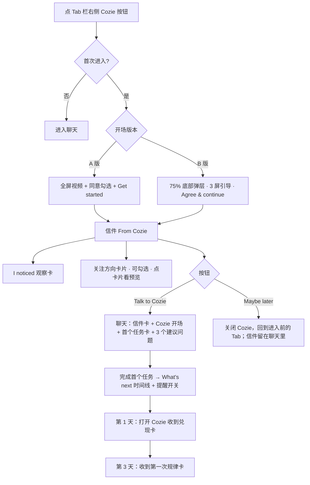

# PRD · Cozie 首次进入（冷启动 Onboarding）

> 依据：CozyAI demo 当前实现（截至 2026-11-24）与《Cozie 首次进入流程 · 评审材料》第 2 版（docs/onboarding-review.md）。界面文案保留英文原文（产品面向欧美市场）。未确认信息统一标注 `[待补充：…]` 并列入第 14 章。

---

## 1. 基础信息

| 字段 | 内容 |
|---|---|
| 产品负责人 | [待补充：需求 Owner 姓名] |
| 版本 | v0.1 |
| 状态 | 草稿 |
| 需求类型 | 新功能 |
| 关联文档 | 评审材料：docs/onboarding-review.md；可体验 demo：[待补充：Vercel 线上地址]；记忆与上传系统 PRD：docs/prd-memory-upload.md；Figma：[待补充：链接]；数据看板：[待补充：链接] |

## 2. 需求背景

- **业务背景**：Momcozy App 内上线 AI 助手 Cozie（粉色兔子形象）。Cozie 背后有泌乳助手、睡眠助手、CareLog（健康成长记录，所有方向通用）和陪伴闲聊。大部分用户是 Momcozy 设备用户（吸奶器、婴儿监视器、白噪音机、瑜伽球），他们的 Momcozy 账号里**已经有**宝宝资料、成长记录和设备数据。这是通用 AI 没有的冷启动优势，但用户第一次打开 Cozie 时看不到。
- **用户问题**：刚生完孩子的妈妈睡眠不足、常单手操作手机。她第一次打开 AI 助手时，面对空白聊天框不知道问什么；即使问了，回答也和通用 AI 差不多，感觉不到"它认识我"。冷启动多一步就多一批流失。
- **问题影响**：首次体验平淡 → 不再回来，AI 功能渗透率和留存低；用户不知道"告诉 Cozie 越多回答越准"，也就不会授权或导入更多信息，Cozie 的个性化能力无从积累。
- **相关证据**：[待补充：现有 AI 对话首日/次日留存、首问率等数据；用户访谈或客服反馈]。本期 demo 尚无埋点数据。

**需求价值**

| 维度 | 价值 |
|---|---|
| 用户价值 | 首次进入就拿到一条基于她自己数据的观察，并当场完成一件小事（吸奶计划 / 睡眠节奏 / 体检清单 / 情绪陪伴）；所有数据标明来源，随时可改可删，有安全感 |
| 商业价值 | 提升 AI 首次使用完成率与次日、第 3 天回访；带动设备数据授权与资料导入，为后续个性化与订阅打基础 [待补充：对应的 KPI/OKR] |
| 战略价值 | 用设备数据 + 记忆构建通用 AI 难以复制的个性化壁垒 |

## 3. 用研和数据验证

**3.1 用户需求与场景验证**（产品评审前）
- 目标用户：产后 1–12 周的妈妈，以 Momcozy 设备用户为主；无设备用户为次。
- 真实场景：喂奶 / 吸奶间隙、夜里醒着时，第一次点开 Cozie。
- 待验证：是否高频、重要。[待补充：问卷 / 访谈计划与结论]

**3.2 关键功能与交互方案验证**（UX/UI 设计中、开发前）
- 用可用性测试（8–12 位真实用户）验证：用户是否看懂信件里的观察、是否会点 "Talk to Cozie"、是否理解关注方向卡片的勾选与预览、是否完成第一件小事。
- 已有评审材料（docs/onboarding-review.md 第 10 节）可直接作为评审问卷。
- 待定方案对比：开场 A 版（全屏视频）vs B 版（三屏引导）；信件 Letter（逐行）vs Story（年度报告式）。[待补充：对比测试结论]

**3.3 产品价值、用户价值与成功指标**

> Benchmark 列为团队基线值（来自《产品需求评审——价值与目标》）或评审材料中的建议值，**目标值待与业务确认**后填入。

| 维度 | 衡量指标 | 成功标准（Benchmark） | 验收/评估方式 |
|---|---|---|---|
| 用户价值\* | 引导完成率：打开 Cozie → 看到信件 → 点击 Talk to Cozie 或 Maybe later | [待补充：目标值]（基线：关键流程完成率 ≥60%） | 埋点漏斗：`cozie_intro_view` → `cozie_letter_view` → `cozie_letter_cta_click` |
| 用户价值\* | 首个个性化结果时间：打开 Cozie → 第一张基于账号数据的观察或任务结果出现 | < 60 秒（评审材料建议值，待确认） | 埋点时间差 |
| 用户价值\* | 第一件小事完成率：首个任务卡被完成（保存计划 / 节奏 / 清单，或请求明天问候） | [待补充：目标值]（基线 ≥60%） | 埋点：`cozie_first_task_view` → `cozie_first_task_complete` |
| 用户价值\* | 回访：完成首个任务的用户在第 1 天、第 3 天再次打开 Cozie 的比例 | [待补充：目标值]（基线：功能次周留存 ≥35%） | 以 `cozie_first_task_complete` 为起始事件，看 D1、D3、D7 的 `cozie_open` |
| 用户价值 | 兑现卡打开率：到期的 Day 1 / Day 3 卡被看到的比例；提醒开启率 | [待补充：目标值] | 埋点：`cozie_next_step_delivered`、`cozie_next_step_reminder_toggle` |
| 用户价值 | 关注方向保留率：至少保留 1 个方向的用户比例 | [待补充：目标值] | 埋点：`cozie_focus_toggle` |
| 软件质量体验\* | SQE | ≥5.5 / 7（上线标准） | 用研问卷 |
| 用户情感 | 主观智能感评分 | ≥4 / 5 | 首次体验后极简评价（五星 + 标签）[待补充：是否本期做] |
| 专业信任 | 观察文案、常见问题文案科学性 | 专家评审合格率 100% | 3 位及以上 IBCLC / 医学专家背靠背审阅（见第 12 章） |

**3.4 效果复盘**：上线后 T+7、T+15、T+30 数据复盘，之后每月例行复盘。重点看引导漏斗各步流失、四种账号类型（吸奶器+监视器 / 仅吸奶器 / 仅监视器 / 无设备）分别的表现。

## 4. 竞品分析

- **竞品选择**：Apple 健康 App 首次引导（评审中作为风格参考）；Claude 移动端首次进入（引导节奏参考）；通用 AI 助手（ChatGPT 等）空白首屏。
- **关键发现**：Apple 健康用"动画迷你手机 + 一句标题"的短引导解释价值，再请求权限；通用 AI 首屏为空白输入框，冷启动依赖用户自己想问题。
- **对本需求的启示**：借鉴短引导与"先说价值再要权限"；规避一上来要权限或给空白首屏。差异化在于**第一屏就用她自己的设备 / 账号数据给出观察**，并以一封"From Cozie"的信承载温度与品牌感。
- **竞品分析文档**：[待补充：链接]

## 5. 用户核心场景

**目标用户**

| 角色 | 说明 | 本期优先级 |
|---|---|---|
| 吸奶器用户 | 关心泌乳、吸奶节奏 | P0 |
| 监视器 / 白噪音用户 | 关心宝宝睡眠、成长 | P0 |
| 无设备用户 | 产后生活、体检、情绪 | P1 |
| 瑜伽球用户（孕产康复） | 本期未覆盖，见第 14 章 | — |

**核心使用场景**
1. 当妈妈第一次点开 Cozie 时，她想要很快知道这个助手能为她做什么、和别的 AI 有什么不同，以便决定要不要花时间用它。
2. 当她读到 Cozie 的第一封信时，她想要看到一条关于自己和宝宝、她自己没注意到的观察，以便相信 Cozie 真的"认识她"。
3. 当她进入聊天时，她想要当场完成一件实际有用的小事（例如把吸奶时间排进宝宝的睡眠里），以便立刻得到价值，而不是从空白输入框开始。
4. 当她完成这件事后，她想要知道接下来会发生什么、什么时候值得再回来，以便第二天、第三天看到效果。
5. 当她暂时没空时，她想要能先关掉、回到原来的页面，以便之后再看，而不被强行留在 AI 页面。

**场景优先级**：1、2、3 为 P0；4 为 P0（回访钩子）；5 为 P1。

## 6. 需求概述

**功能摘要**：为第一次打开 Cozie 的 Momcozy 妈妈，用一段短开场、一封基于她账号数据的信和一件当场完成的小事，让她在一分钟内感到"Cozie 认识我、有用"，并约好第二天和第三天回来看结果。

**流程图**

**需求配图**：[待补充：Figma 关键帧——开场 A/B、信件、预览弹窗、首个任务卡、兑现卡]

**需求详情一致性**：需求详情如同时写在 Figma 中，以本文档为准。

**Feature List（功能清单）**
- 首次入口：首次点 Cozie 按钮 —> 自动进入开场，不直接给空白聊天。
- 开场 A 版：看约 20 秒介绍视频，勾选同意后点 Get started —> 进入信件。
- 开场 B 版：在 75% 高的底部弹层里翻 3 屏，点 Agree & continue —> 显示 "You're all set" 后升起信件。
- 信件 From Cozie：信封自动拆开，内容逐行出现 —> 看到阶段、温情开场、一条观察、关注方向。
- I noticed 观察卡：有数据时看到基于她数据的洞察 —> 没数据时看到同阶段妈妈的常见问题和 Cozie 的对应功能。
- 关注方向卡片：点勾选框 —> 勾选或取消方向；点卡片其他位置 —> 弹出预览弹窗。
- 预览弹窗：查看某方向能做什么、观察、如何让回答更准 —> "Include in my Cozie" 开关与卡片勾选同步。
- Talk to Cozie：点按钮 —> 进入聊天，看到 Cozie 的开场与对应方向的首个任务卡。
- Maybe later：点链接 —> 关闭 Cozie，回到进入前的 Tab；引导记为完成，信件留在聊天里可重读。
- 首个任务卡：完成任务（保存计划 / 节奏 / 清单，或请求明天问候）—> 卡片显示 What's next 时间线与提醒开关。
- 回访兑现：第 1 天 / 第 3 天打开 Cozie —> 收到约定的结果卡。
- 个性化上下文：之后每次提问 —> 模型收到账号数据摘要、她选的方向和记忆档案，回答引用真实数字并标来源。

**范围边界 — 本期包含**
- 开场 A、B 两版（用于对比，上线版本待定），B 版的权限屏已关闭（代码保留）。
- 信件（Letter 逐行版为默认；Story 年度报告式为可切换的对比方案）。
- I noticed 观察卡（有数据 / 无数据两种）、关注方向卡片、预览弹窗。
- 进入聊天后的开场消息、首个任务卡（4 种）、模型生成的 3 个建议问题（失败时用内置问题兜底）。
- Maybe later 返回进入前的 Tab。
- 首个任务的回访钩子：What's next 时间线、提醒开关、第 1 天 / 第 3 天兑现卡。
- 四种账号类型的分流（吸奶器+监视器 / 仅吸奶器 / 仅监视器 / 无设备）。

**范围边界 — 本期不包含**
- 真实推送通知：提醒开关目前只申请系统通知权限，App 外推送需要 Service Worker / 原生推送和后端定时任务，另行立项。
- 瑜伽球 / 孕产康复方向：孕期与产后人设差异大，待定（第 14 章）。
- 方向聚合页（整页）：已做好，但不放进引导，计划作为长期入口另行评审。
- 引导中的权限屏（Apple Health 连接、提醒）：还没给价值就先要权限，本期关闭。
- 记忆档案、数据来源、资料导入：见《记忆与上传系统 PRD》。
- "Ask Cozie" 推荐问题（预览弹窗内）：本期隐藏，代码保留。

**对现有功能的影响**
- Cozie 聊天页：首次进入前插入开场与信件；聊天流新增信件卡、首个任务卡、兑现卡等卡片类型。
- 原"保存吸奶计划后第二天问一句怎么样"的逻辑被回访钩子替代。
- 吸奶计划卡原有的 "Nudge me before each session" 提醒被 "Tell me when it's ready" 替代。[待补充：是否需要另行保留"每次吸奶前提醒"]
- Tab 栏与其他 Tab：无影响（Cozie 以覆盖层打开，关闭后回到原 Tab）。

## 7. 详细需求

按用户流程组织。

### 7.1 首次入口

1. **功能描述**：App 底部 4 个 Tab（Home / Device / Community / Me）右侧有独立的圆形 Cozie 按钮。首次点开时进入开场，之后直接进聊天。
2. **交互说明**：Cozie 从按钮位置圆形扩散，盖住当前 Tab；B 版开场为底部弹层，不播放圆形扩散，上方 25% 露出**当前 Tab**（压暗）。
3. **规则与逻辑**："首次"= 本设备未完成过引导且没有历史会话。完成引导（Talk to Cozie 或 Maybe later）后写入已完成标记。
4. **异常与边界**：引导中途关闭（右上角 X）→ 下次打开仍从开场开始；系统开启"减少动态效果"→ 不播放扩散动画。

### 7.2 开场 A 版 · 全屏视频

1. **功能描述**：全屏播放约 20 秒介绍视频，只播一次，停在最后一帧。
2. **交互说明**：底部渐变遮罩上有勾选框 "I agree to Privacy statement · Medical disclaimer" 和按钮 "Get started"。
3. **规则与逻辑**：未勾选点击 Get started → 提示先勾选同意；勾选后进入信件。隐私声明与医疗免责声明可点开查看。
4. **异常与边界**：视频加载失败 → 显示静态封面，勾选与按钮照常可用；当前视频为原型录屏占位，需设计导出正式版本 [待补充]。

### 7.3 开场 B 版 · 三屏引导

1. **功能描述**：75% 高的底部弹层，3 屏，每屏上半为动画迷你手机，下半为标题与说明，顶部进度条，可返回。
2. **交互说明**：

| 屏 | 标题 | 内容 | 按钮 |
|---|---|---|---|
| 1 | Here for you, even at 3 a.m. | Cozie keeps an eye on feeds, sleep and pumping, and checks in when you need it. | Continue |
| 2 | You never have to start over | 迷你手机逐行出现记忆列表（宝宝 / 喂养 / 吸奶 / 设备 / 睡眠），说明可随时查看、编辑、删除 | Continue |
| 3 | Honest when it matters | 三条承诺：Asks first / Knows its limits / Private by default；底部小字说明点击即同意隐私声明与医疗免责声明 | Agree & continue |

完成后显示大对勾 "You're all set"，信件随即升起。
3. **规则与逻辑**：第 4 屏权限页由开关关闭（代码保留）；"点击即同意"是否满足合规要求待法务确认（第 12、14 章）。
4. **异常与边界**：中途下滑关闭弹层 → 视为未完成引导。

### 7.4 信件 "From Cozie"

1. **功能描述**：按账号生成的第一封信，可复用为以后周期性来信。从上到下：信头（momcozy 标志、From Cozie、"Your first letter · 日期"；右上角阶段 "● Week 6" 与迷你阶段条）→ 温情开场段 → I noticed 观察卡 → 关注方向卡片 → 情感话 "You're doing more than you think." → 署名 "With you, Cozie" → 来源说明 → 主按钮 Talk to Cozie、文字链接 Maybe later。
2. **交互说明**：信封自动拆开后内容**逐行出现**；首屏以下滚动到才出现；点信纸任意处立即显示全部；重开信件或"减少动态效果"时直接显示全部。
3. **规则与逻辑**：
   - 开场段中间一句随账号变化，**不带数字**（数字留给观察卡）：有吸奶器 / 只有监视器 / 无设备三种。
   - 来源说明："Based on your Momcozy account. Everything Cozie knows is in your memory profile, where you can change it."
   - 可切换的 Story 版：信封打开后先播几页全屏故事（只用账号真实数据，不把 7 天推算成 6 周），最后一页 I noticed 收拢回信中卡片；点击前进、约 4.6 秒自动前进、右上角 Skip。
4. **异常与边界**：账号数据加载失败 → 观察卡走无数据版本（7.5）；文字未出现前预留位置，排版不跳动；读屏软件一次读到整段文字。

### 7.5 I noticed 观察卡（信件、预览弹窗、方向页共用）

1. **功能描述**：**有数据就给洞察；没数据就给同阶段妈妈的高频问题 + Cozie 的对应功能。**
2. **交互说明**：有数据时：标题、大数字、7 天趋势线、一句解读、数据来源（"From your M5 pump"）。无数据时：眉标 "At 6 weeks"、标题 "What moms ask about …"、3 个问题（每个配功能名标签 + 一句怎么帮）、底部一句"接上设备 / 数据后这张卡会变成你自己的"、来源行 "Common questions at this stage · not from your data"。
3. **规则与逻辑**：
   - 信件选哪条观察：设备趋势优先（她自己不容易看到）——有监视器 → 睡眠；只有吸奶器 → 泌乳；无设备 → 成长记录（体检日期 + 体重）。
   - Momcozy App 里的成长记录也算数据；成长记录少于 2 次体重时视为无数据。
   - 在数据来源中被关掉的数据视为无数据。
   - 文案只描述规律、不诊断（只说"这个阶段很典型"，不说"宝宝很健康"）。
   - 各方向无数据时的常见问题与对应功能：

| 方向 | 常见问题 → 功能 |
|---|---|
| Pumping | 乳房变软是不是奶少了 → Feeding log；突然一直要吃 → Smart pumping schedule；回去上班怎么保持奶量 → AI lactation plan |
| Sleep | 为什么还是每两三个小时醒 → Sleep patterns；白天睡、晚上醒 → Nap and bedtime rhythm；我自己怎么多睡点 → Help with night wakings |
| Growth log | 体重长得够不够 → Growth log；2 月龄体检做什么 → Check-up reminders；接下来打什么疫苗 → Vaccine reminders |
| Feelings | 还是很低落正常吗 → Talk anytime（持续超过两周会引导她找专业帮助）；没有自己的时间 → Time for you；觉得孤单 → Gentle check-ins |

4. **异常与边界**：常见问题文案需医学专家审阅（第 12 章）；当前按 6 周编写，其他周龄的文案 [待补充]。

### 7.6 关注方向卡片 + 预览弹窗

1. **功能描述**：信中 "I'll keep an eye on these for you:" 下四张卡片：Pumping / Sleep / Growth log / Feelings。
2. **交互说明**：勾选框（约 44px 点击区）与卡片其余部分是**两个独立点击区域**：点勾选框 → 勾选 / 取消；点其他位置 → 底部弹出预览弹窗。预览弹窗内容：方向标题与对应助手、能做什么（3 条）、观察卡（7.5）、"Make answers sharper"（上传文件 / 导入其他 AI 的记忆，标注 Optional）、底部固定 "Include in my Cozie" 开关（与卡片勾选同步）。
3. **规则与逻辑**：默认勾选按设备：吸奶器 → Pumping；监视器 → Sleep；无设备 → Growth log。匹配的卡片排在前面。她的选择会保存，之后每次聊天告诉模型"她希望 Cozie 侧重哪些方向"。Feelings 卡片刻意不放推断数据（避免"被盯着"的感觉）。
4. **异常与边界**：全部取消勾选 → 允许，聊天不带方向偏好；只保留 Feelings → 首个任务卡为情绪卡（7.8）。

### 7.7 进入聊天（Talk to Cozie）与暂不进入（Maybe later）

1. **功能描述**：Talk to Cozie → 聊天中先出现信件卡（可重读），然后是 Cozie 的开场消息与首个任务卡，任务卡下方 3 个建议问题。Maybe later → 关闭 Cozie。
2. **交互说明**：建议问题点了即作为问题发出。Maybe later 时 Cozie 以收回动画关闭，回到进入 Cozie 之前所在的 Tab。
3. **规则与逻辑**：
   - 3 个建议问题由模型在用户读信时预生成（结合账号数据与该阶段高频问题），8 秒超时或失败时用内置问题补齐，始终 3 个。
   - Maybe later：引导仍记为完成；信件卡和一句不催促的话（"No rush at all. Your letter is right here whenever you'd like to read it again…"）留在聊天里，下次打开可见。
   - 重播引导（演示用）时 Maybe later 同样回到原 Tab，不重复投放信件。
   - 之后每次提问，模型收到：账号数据摘要、她选的方向、记忆档案；规则：引用真实数字、说明来源、不编造、不诊断、健康信息只在相关时提及。
4. **异常与边界**：模型不可用 → 开场与任务卡为固定文案，照常可用；聊天回答失败提示 "Sorry, I couldn't reach the assistant right now. Please try again."。

### 7.8 首个任务卡

1. **功能描述**：每个方向一张"帮她做一件事"的卡，按账号自动选择：

| 卡片 | 何时出现 | 完成动作 |
|---|---|---|
| 吸奶计划（Plan my pumping around Noah's sleep） | 有吸奶器 | 用她本周 M5 记录生成计划 → Save this plan（存入 Lactation plan） |
| 睡眠节奏（Help Noah's long sleep land at night） | 有监视器、无吸奶器 | 3 步晚间节奏 → Save this rhythm |
| 体检清单（Get ready for Noah's check-up） | 无设备；或从其他卡点 "Make my check-up checklist" | 4 项清单 → Save this checklist |
| 情绪（How are you, really?） | 只保留 Feelings 方向 | Let's talk / Check in with me tomorrow |

2. **交互说明**：卡片有"未完成 → 完成"两态。未完成时，主按钮上方一句动机（如 "Save it, and tomorrow I'll show you how day one went."）。完成后显示 "Done" 与 What's next（7.9）。
3. **规则与逻辑**：吸奶计划时间由本地规则从设备数据计算（取最完整的一天，归整到半小时），**不由模型生成**；保存后写入她的泌乳计划。完成状态持久化，刷新后仍显示完成。
4. **异常与边界**：没有吸奶数据 → 不出吸奶卡；重复完成不会重置时间线。

### 7.9 回访钩子：What's next、提醒、兑现卡

1. **功能描述**：完成首个任务后，约定"明天给你看什么、第 3 天给你看什么"，到期时兑现。
2. **交互说明**：
   - 完成态卡片内 "What's next" 时间线：Tomorrow / Day 3 两步，兑现后变为绿色 "Ready"；下方开关 "Tell me when it's ready"（体检、情绪为 "Remind me tomorrow"）。
   - 到期后打开 Cozie，聊天里出现 Cozie 一句开场 + 兑现卡（眉标 "As promised" / "Day 3"），部分附 2 个建议问题。

| 卡片 | 第 1 天 | 第 3 天 |
|---|---|---|
| 吸奶计划 | 昨天按计划完成几次、总量、夜间那次多少（来自 M5） | 近 3 天奶量趋势与"稳不稳" |
| 睡眠节奏 | 昨晚最长一觉，与前一晚对比、夜醒次数（来自 BM04） | 3 晚逐晚对比 |
| 体检清单 | 两问快速记录：昨天喂了几次、最长睡多久 | 给医生的小结：喂养、睡眠、最近体重、体检日期 |
| 情绪 | 一次问候："How was last night for you?"（三个选项） | 不做（情绪不追踪） |

3. **规则与逻辑**：
   - 以"完成任务的那天"为第 0 天；第 1 天、第 3 天当天或之后首次打开 Cozie 时投放。
   - 离开超过 3 天才回来 → 只投第 3 天那张，不连发。
   - 每张兑现卡只投一次。
   - 提醒开关打开时申请系统通知权限；**本期不发真实推送**（见范围边界），推送文案取兑现卡的标题与开场句。
   - 不做连续打卡、不说"想你了"、夜间不推送 [待补充：推送时段规则]。
4. **异常与边界**：用户拒绝通知权限 → 开关仍记为开（兑现卡照常在 App 内出现），[待补充：拒绝权限时的提示文案]；设备数据缺失 → 兑现卡改为说明缺数据并给出补录入口 [待补充]。

## 8. 设计稿 UX & UI

- **设计稿**：[待补充：开场 A/B、信件（Letter / Story）、观察卡两态、关注方向卡片、预览弹窗、首个任务卡两态、What's next、兑现卡]
- **Figma 链接**：[待补充]
- 可体验 demo：[待补充：线上地址]（桌面端左侧 Demo controls 可切换开场版本、信件样式、4 种账号，以及 "Skip to tomorrow / Skip to day 3"）

## 9. Feature List —（用户开发测试验收）

| 编号 | 功能简述 | 优先级 | 预估工作量 | 负责人 |
|---|---|---|---|---|
| OB-01 | 首次进入判断与入口（圆形扩散 / 弹层） | P0 | [待评审] | [待补充] |
| OB-02 | 开场 A 版：视频 + 同意勾选 + Get started | P0 | [待评审] | [待补充] |
| OB-03 | 开场 B 版：三屏引导弹层 + Agree & continue | P0 | [待评审] | [待补充] |
| OB-04 | 信件框架：信头阶段、开场段（按账号）、署名、来源说明、按钮 | P0 | [待评审] | [待补充] |
| OB-05 | 信件逐行出现与点击跳过、减少动态效果 | P1 | [待评审] | [待补充] |
| OB-06 | I noticed 观察卡：有数据洞察（3 个方向）+ 选择规则 | P0 | [待评审] | [待补充] |
| OB-07 | I noticed 无数据版：同阶段常见问题 + 功能对应 | P0 | [待评审] | [待补充] |
| OB-08 | 关注方向卡片：默认勾选、双点击区、持久化、传给模型 | P0 | [待评审] | [待补充] |
| OB-09 | 预览弹窗与 Include in my Cozie 同步 | P1 | [待评审] | [待补充] |
| OB-10 | Talk to Cozie：信件卡 + 开场 + 首个任务卡 + 模型预生成 3 个建议问题（含兜底） | P0 | [待评审] | [待补充] |
| OB-11 | Maybe later：关闭回到原 Tab，引导记完成，信件留在聊天 | P1 | [待评审] | [待补充] |
| OB-12 | 首个任务卡 4 种（含吸奶计划本地计算与保存） | P0 | [待评审] | [待补充] |
| OB-13 | What's next 时间线 + 提醒开关（申请通知权限） | P0 | [待评审] | [待补充] |
| OB-14 | 第 1 天 / 第 3 天兑现卡投放与 7 种卡片内容 | P0 | [待评审] | [待补充] |
| OB-15 | Story 年度报告式开场（对比方案） | P2 | [待评审] | [待补充] |
| OB-16 | 真实推送（另行立项） | — | — | — |

## 10. 数据需求

**数据埋点**（事件名为建议，具体由数据产品经理确认）

| 事件名称 | 触发时机 | 携带参数 |
|---|---|---|
| `cozie_open` | 打开 Cozie | is_first_run, entry_tab, account_type |
| `cozie_intro_view` | 开场出现 | variant（A/B） |
| `cozie_intro_step_view` | B 版每屏出现 | step（1–3） |
| `cozie_intro_consent` | 勾选同意 / 点 Agree & continue | variant |
| `cozie_intro_close` | 引导中途关闭 | variant, step |
| `cozie_letter_view` | 信件打开 | letter_style（letter/story）, account_type, insight_focus |
| `cozie_letter_skip_animation` | 点信纸显示全部 / Story Skip | letter_style, progress |
| `cozie_insight_view` | 观察卡出现 | focus, has_data |
| `cozie_focus_toggle` | 勾选 / 取消方向 | focus, checked, source（card/sheet） |
| `cozie_focus_preview_open` | 打开预览弹窗 | focus |
| `cozie_letter_cta_click` | 点 Talk to Cozie / Maybe later | cta, time_since_open_ms |
| `cozie_first_task_view` | 首个任务卡出现 | task_kind |
| `cozie_first_task_complete` | 完成首个任务 | task_kind, time_since_open_ms |
| `cozie_first_chip_click` | 点首组建议问题 | task_kind, chip_index, chip_source（model/fallback） |
| `cozie_next_step_reminder_toggle` | 切换提醒开关 | task_kind, on, permission_result |
| `cozie_next_step_delivered` | 投放兑现卡 | task_kind, day, days_since_start |
| `cozie_next_step_interact` | 兑现卡内点击（建议问题、快速记录、情绪选项） | task_kind, day, action |

**后端记录**：首个任务开始日、兑现卡投放记录（用于 D1/D3 回访分析）；[待补充：推送发送记录（推送立项后）]。

**数据看板**：新建 "Cozie 冷启动" 看板，展示：引导漏斗（开场 → 信件 → CTA → 首个任务完成）、首个个性化结果时间分布、首个任务完成率（按账号类型）、D1/D3/D7 回访、兑现卡投放与互动率、提醒开启率。指标对应第 3.3 节。

**埋点需求单**：[待补充：按《数据埋点需求单》规范另附]

## 11. 多语言

- **涉及语种**：英语（本期）；[待补充：其他欧美语种，如德、法、西]
- **需送翻内容**：开场视频字幕与 B 版三屏文案；信件全部文案（含随账号变化的句子）；观察卡与常见问题文案；关注方向卡片与预览弹窗；首个任务卡、What's next、兑现卡文案；推送文案（推送立项后）；隐私声明、医疗免责声明。字数估算 [待补充]。
- **送翻时间节点**：[待补充]
- **翻译文本链接**：[待补充]
- **本地化特殊要求**：日期格式（Nov 23）、时间格式（3:00 a.m.）、单位（ml / oz、kg / lb）需按地区切换；信件逐行出现按实际排版断行，长语种可能增加行数与滚动距离；"Week 6" 等阶段表达需本地化。
- **多语言风险披露**：信件为情感化文案，直译易失去温度（中风险，需本地化润色）；健康相关文案翻译需医学复核（高风险）。

## 12. 合规与安全

- **合规审核状态**：🔴 未审核

**合规自检表**

| # | 问题 | 回答 | 说明 |
|---|---|---|---|
| 1 | 是否新增收集个人信息？ | 是 | 读取已有账号数据（宝宝资料、成长记录、设备数据）用于 AI 回答；新增保存关注方向选择、首个任务完成状态、快速记录（喂养次数、睡眠时长）。1.1 隐私政策需写明 AI 使用这些数据 [待法务]；1.2 涉及婴幼儿与健康 / 生理数据（敏感）；1.3 开场有同意勾选 / Agree & continue，是否需单独弹窗待法务确认；1.4 撤回途径：设置中关闭记忆 / 关闭数据来源（见记忆与上传 PRD）[待补充：撤回 AI 数据使用的总入口] |
| 2 | 是否申请系统敏感权限？ | 是 | 通知权限：在用户打开 "Tell me when it's ready" 时动态申请（2.1 是）；开关文案说明用途（2.2 是）。原引导中的 Apple Health 权限屏本期关闭 |
| 3 | 是否涉及第三方？ | 是 | 对话与建议问题生成调用第三方大模型（DeepSeek、Anthropic）。3.1 隐私政策第三方共享章节需更新 [待法务]；3.2–3.4 无用户间共享 |
| 4 | 数据是否跨境？ | 是（待确认） | 4.1 账号数据摘要、记忆、对话内容；4.2 生成 AI 回答；4.3 模型服务所在国 [待补充：DeepSeek / Anthropic 服务区域与数据驻留]。**高风险，需法务重点评估** |
| 5 | 是否包含个性化推荐 / 自动化决策？ | 是 | 按设备默认勾选方向、按账号选择观察与首个任务、吸奶计划时间计算。5.1 方向可手动取消，计划可修改；[待补充：是否需要全局关闭个性化的开关]；5.2 设备数据、成长记录、方向选择；5.3 提供相关帮助 |
| 6 | 是否使用 AI 能力？ | 是 | 6.1 AI 问答、建议问题生成；6.2 回答下方显示 "For information purpose only. Not medical advice."；6.3 违规过滤 [待补充]；6.4 是否用于模型训练 [待补充：需与模型服务商条款核对]；6.5 无深度合成 |
| 7 | 是否允许用户上传 / 发布内容？ | 否（本 PRD） | 资料导入见记忆与上传 PRD |
| 8 | 是否支持用户间互动？ | 否 | — |
| 9 | 是否涉及未成年人？ | 是 | 9.1 内容与数据涉及婴幼儿（0–12 月）；9.2 0–12 岁（数据主体为婴儿，用户为成年父母）；9.3 [待补充：注册年龄限制] |
| 10 | 是否新增用户可见内容？ | 是 | 10.1 引导文案、信件、观察、常见问题、任务卡、AI 回复、推送；10.2 健康相关内容带免责声明，开场需同意 Medical disclaimer；10.3 避免绝对化用语与功效承诺（如不写"宝宝很健康"、不承诺"增加奶量"） |

- **医疗内容合规**：涉及健康指导（吸奶时间、睡眠节奏、体检准备、情绪），不做诊断，只描述规律；情绪卡中"低落持续超过两周 → 引导寻求专业帮助"需医学专家确认措辞；所有观察、常见问题文案需 IBCLC / 儿科 / 心理专家审阅。
- **数据安全**：[待补充：传输加密、存储加密、访问控制、审计日志、泄露应急预案]。demo 阶段数据存于浏览器本地与 Upstash（会话历史），正式版需技术方案。
- **用户权利保障**：数据访问 / 删除通过记忆档案与数据来源页实现（见记忆与上传 PRD）；同意机制见自检表第 1 项；隐私政策需更新 [待法务]。
- **法务专家审核意见**：[待补充：审核人 / 日期 / 结论]
- **医疗专家审核意见**：[待补充：审核人 / 日期 / 结论]

## 13. 发布与运营

- **灰度 / 发布计划**：[待补充]。建议：先对新用户按账号类型分层灰度（如 10%），观察 1–2 周引导漏斗与 D1/D3 回访，A/B 开场对比出结论后推全。
- **运营配合**：[待补充] 例如：Story 版可在满月 / 满 6 周等节点作为运营触达；推送立项后配置推送文案与时段。
- **回滚方案**：触发条件——引导完成率显著低于对照、崩溃率或投诉上升 [待补充：阈值]；步骤——关闭首次引导开关，首次进入直接进聊天；影响范围——仅影响未完成引导的新用户，已保存的计划与选择不受影响。

## 14. 开放问题与决策记录

**待确认问题**

| # | 问题 | 责任人 | 期望确认时间 |
|---|---|---|---|
| 1 | 上线采用开场 A 版还是 B 版？ | [待补充] | [待补充] |
| 2 | 信件默认 Letter 还是 Story？Story 是否更适合满月等节点？ | [待补充] | [待补充] |
| 3 | "点 Agree & continue 即视为同意"是否合规？是否需单独同意弹窗？ | 法务 | [待补充] |
| 4 | 第三方模型（DeepSeek、Anthropic）的跨境传输与数据驻留是否可接受？ | 法务 / 安全 | [待补充] |
| 5 | 瑜伽球用户按孕期还是产后处理？是否需要孕期人设？ | 产品 | [待补充] |
| 6 | 真实推送何时立项？推送时段与频率规则？ | 产品 / 技术 | [待补充] |
| 7 | 吸奶计划卡是否保留"每次吸奶前提醒"？ | 产品 | [待补充] |
| 8 | 常见问题文案是否用社区 / 客服真实高频问题替换？其他周龄文案？ | 产品 / 内容 | [待补充] |
| 9 | 用户数据是否会被模型服务商用于训练？ | 法务 / 技术 | [待补充] |
| 10 | 各成功指标目标值 | 产品 / 数据 | [待补充] |

**已确认决策**

| 决策 | 依据 | 日期 |
|---|---|---|
| 按五步框架组织：Welcome → First insight → First action → More personal → Ongoing | 每一步只做一件事 | 2026-11-24 |
| 所有版本都以信件收尾；信件名为 "From Cozie"（不叫 Weekly Letter） | 仪式感，可复用为周期来信 | 2026-10-30 |
| 信件只放一条观察；有数据给洞察，无数据给同阶段常见问题 + 功能 | 一条讲透；不让无数据用户看到空卡 | 2026-11-24 |
| "第一件小事"放在聊天里，不放信里 | 对话中更自然，模型有上下文 | 2026-11-24 |
| 关闭引导中的权限屏 | 还没给价值就要权限 | 2026-11-23 |
| 无设备默认勾选 Growth log | 与信件观察（体检）一致 | 2026-11-24 |
| Maybe later 回到进入前的 Tab | 用户暂时没空时不强留 | 2026-11-24 |
| 回访钩子放在首个任务卡完成态里，情绪只做一次问候 | 刚完成任务时约定最可信；情绪不追踪 | 2026-11-24 |
| 文案不诊断、数据必标来源 | 合规与信任 | 2026-10-30 |

## 15. 变更记录

| 日期 | 更新人 | 更新内容 |
|---|---|---|
| 2026-11-24 | [待补充] | v0.1 初稿：根据 demo 当前实现与评审材料整理 |
